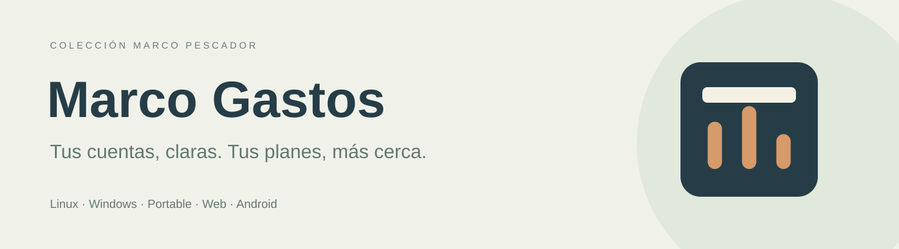
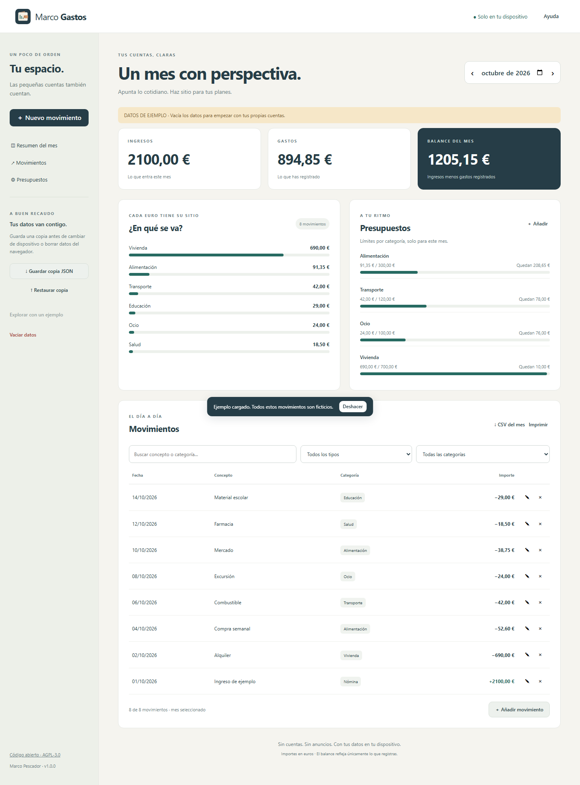
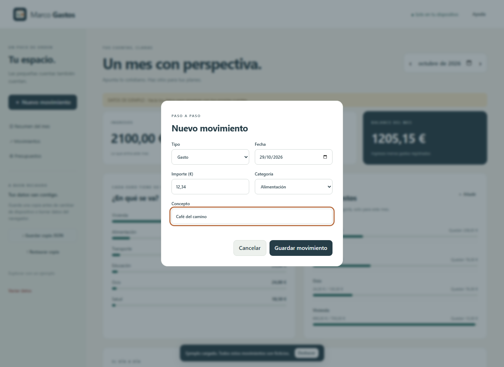
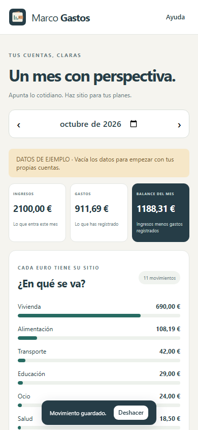

# Marco Gastos

**Gastos, ingresos y presupuestos mensuales. En tu dispositivo, sin cuentas ni anuncios.**

[Abrir la web](https://peskysa.github.io/marco-gastos/) · [Descargar versiones](https://github.com/Peskysa/marco-gastos/releases/latest) · [Manual](docs/MANUAL.md) · [Instalación](docs/INSTALACION.md)

Autor: **Marco Pescador** · Código y gráficos originales: **AGPL-3.0-only**.

## Qué puedes hacer

- Registrar, editar y eliminar gastos e ingresos en euros, con fecha, categoría y concepto.
- Consultar ingresos, gastos, balance y reparto de gastos por mes.
- Fijar presupuestos por categoría y mes; ver lo disponible o el exceso.
- Buscar sin distinguir tildes y filtrar movimientos por tipo y categoría.
- Deshacer el último cambio durante la sesión y mantener los datos al cerrar.
- Guardar y restaurar copias JSON de todos los meses; exportar CSV mensual e imprimir.
- Explorar un ejemplo explícitamente ficticio cuando tus datos están vacíos.
- Trabajar sin conexión después de cargar la web; escritorio y Android incluyen los recursos.

Empieza vacío. No se conecta a bancos, no calcula el saldo bancario y no sincroniza dispositivos. Cada modalidad conserva datos separados. El balance refleja solo lo registrado. Los presupuestos no se repiten automáticamente. Los filtros afectan a la tabla; resumen, CSV e impresión incluyen el mes completo.

## Cinco modalidades

| Modalidad | Archivos y requisitos |
|---|---|
| Windows | Instalador x64 para Windows 10/11 |
| Portable | Ejecutable Windows x64; datos junto al ejecutable, carpeta escribible |
| Linux | DEB y TAR.GZ x64, distribución compatible con Electron, sesión gráfica |
| Web | GitHub Pages, ZIP y lanzador Web Portable para Windows |
| Android | APK firmado; Android 8 o posterior y Android System WebView actualizado |

Los ejecutables Windows no tienen firma comercial. Android no está publicado en Google Play ni verificado en teléfono físico. Web Portable usa el navegador y el puerto local 5197; sus datos se guardan en ese navegador, no en la carpeta del ejecutable. Consulta [distribución](docs/DISTRIBUCION.md).

## Capturas reales

Interfaz ejecutada con datos ficticios, identificados como ejemplo.

## Manual e instalación

[Manual](docs/MANUAL.md) · [Instalación](docs/INSTALACION.md) · [Documentación](docs/README.md) · [Capturas](docs/CAPTURAS.md)

## Desarrollo y pruebas

Node.js 24 y pnpm 11.25.0. `pnpm install --frozen-lockfile`, `pnpm test`, `pnpm build:web`, `pnpm exec playwright install chromium`, `pnpm test:browser`. La web no tiene dependencias JavaScript de terceros en ejecución. Electron proporciona el escritorio y Android utiliza WebView. [Guía de desarrollo](docs/DESARROLLO.md).

El workflow prueba la lógica y el navegador, crea Windows/Linux/Android, comprueba el arranque y la persistencia del escritorio, verifica los paquetes y la firma APK, y publica el conjunto completo. Los informes quedan en Actions. [Estado y límites](docs/ESTADO.md).

## Privacidad

Sin cuentas, anuncios, analítica ni envíos de movimientos. Datos y copias sin cifrado propio. Protege el dispositivo y guarda copias periódicas; borrar el almacenamiento o desinstalar puede eliminar los datos. GitHub recibe las peticiones para servir la web. [Privacidad](docs/PRIVACIDAD.md).

## Licencia y terceros

[AGPL-3.0-only](LICENSE) · [Avisos](NOTICE) · [Terceros](THIRD_PARTY.md) · [Licencia explicada](docs/LICENCIA.md). Las fuentes del mismo commit acompañan cada Release y la web compilada incluye `Source.zip`.

## Historial, contribución y seguridad

[Historial](CHANGELOG.md) · [Contribuir](CONTRIBUTING.md) · [Seguridad](SECURITY.md). No adjuntes movimientos reales ni copias personales en incidencias públicas.
